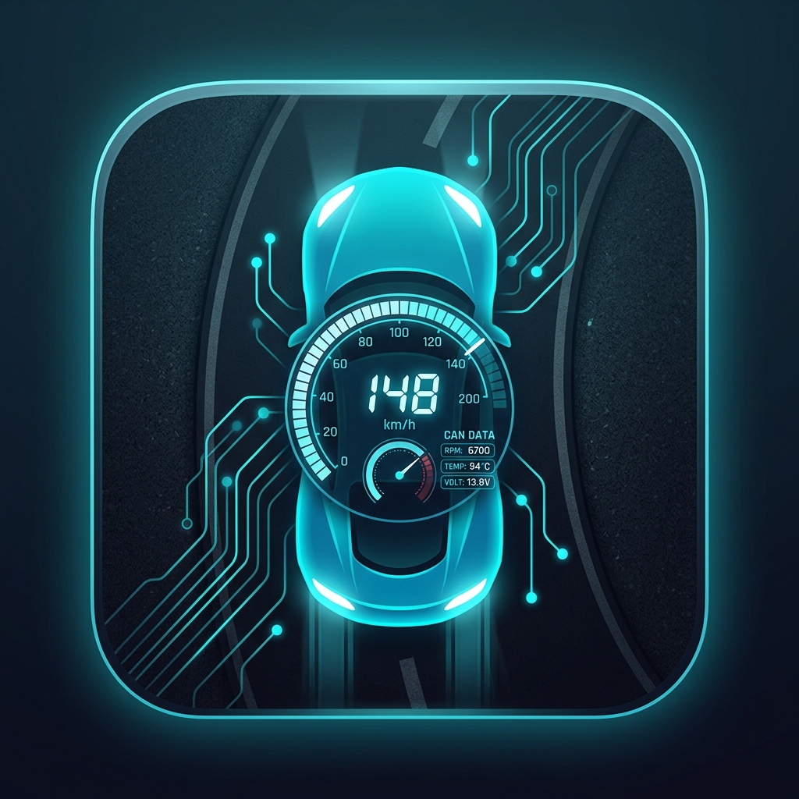

# 🚗 PyCanSim — 2D CAN Bus Automotive Simulator

A real-time, interactive **2D top-down vehicle simulator** that communicates over a live **SocketCAN (vcan0)** virtual CAN bus. Built with Python + Pygame, PyCanSim behaves like a real ECU network: every sensor broadcasts on its own CAN ID at its own cycle time — even when you're not touching the keyboard.

> **Use case:** learning CAN bus protocols, testing automotive security tools (`candump`, `cansend`, `cansniffer`, `canplayer`), or just flexing your car hacking skills in a safe environment.

---

## 📸 Screenshot



---

## 🧠 CAN Protocol — Broadcast IDs

All frames are transmitted continuously at fixed ECU cycle times:

| CAN ID  | Content                          | Cycle  | Encoding |
|---------|----------------------------------|--------|----------|
| `0x0C8` | Engine RPM + Throttle position   | 10 ms  | `uint16 BE` (RPM) + `uint8` (throttle × 2) |
| `0x110` | Vehicle speed + Brake state      | 20 ms  | `uint16 BE` (speed × 100) + `uint8` (0x01=brake) |
| `0x2B0` | Steering angle + Battery voltage | 50 ms  | `int16 BE` (angle × 10, deg) + `uint8` (voltage × 10) |
| `0x290` | Turn signal + Headlights         | 50 ms  | `uint8` (0=off,1=L,2=R,3=hazard) + `uint8` (0x01=on) |
| `0x280` | Door states                      | 100 ms | `uint8` bitmask (bit0=FL, bit1=FR, bit2=RL, bit3=RR) |
| `0x3B0` | Coolant temperature + Fuel level | 200 ms | `uint8` (temp+40 offset) + `uint8` (fuel × 2) |

All sensor values include **realistic ECU noise** (ADC jitter, ripple, micro-corrections).

---

## 🎮 Controls

| Key | Action |
|-----|--------|
| `W` | Throttle / Accelerate |
| `S` | Brake |
| `A` | Left turn signal toggle |
| `D` | Right turn signal toggle |
| `F` | Hazard lights toggle |
| `L` | Headlights toggle |
| `1` | Front-left door toggle |
| `2` | Front-right door toggle |
| `3` | Rear-left door toggle |
| `4` | Rear-right door toggle |
| `ESC` | Quit |

---

## ⚙️ Requirements

- Linux (SocketCAN is Linux-only)
- Python 3.10+
- `can-utils` package for CLI tools
- Kernel modules: `vcan`

---

## 🚀 Installation & Setup

### 1 — Clone the repo

```bash
git clone https://github.com/your-username/PyCanSim.git
cd PyCanSim
```

### 2 — Create virtual environment and install dependencies

```bash
python3 -m venv venv
source venv/bin/activate
pip install -r requirements.txt
```

### 3 — Install can-utils (CLI tools)

```bash
sudo apt install can-utils      # Debian / Ubuntu / Kali
sudo dnf install can-utils      # Fedora
sudo pacman -S can-utils        # Arch
```

### 4 — Set up virtual CAN interface (vcan0)

This needs to be done once per boot (or use the launch script which does it automatically):

```bash
sudo modprobe vcan
sudo ip link add dev vcan0 type vcan
sudo ip link set up vcan0
```

Verify it's up:

```bash
ip link show vcan0
```

### 5 — Run PyCanSim

**Option A — Launch script (recommended, handles vcan0 automatically):**

```bash
chmod +x run_pycansim.sh
./run_pycansim.sh
```

**Option B — Manual:**

```bash
source venv/bin/activate
python pycansim/main.py
```

---

## 🔬 Live CAN Bus Examples

Open a second terminal while PyCanSim is running. All tools work on `vcan0`.

---

### 📡 candump — Live frame monitor

Dump all traffic:

```bash
candump vcan0
```

Filter only speed/brake frames (`0x110`):

```bash
candump vcan0 110:7FF
```

Filter engine ECU frames (`0x0C8`):

```bash
candump vcan0 0C8:7FF
```

Sample output while driving at 80 km/h:

```
vcan0  0C8   [3]  0C 80 6A     # RPM=3200, throttle=53%
vcan0  110   [3]  1F 40 00     # speed=80.00 km/h, brake=off
vcan0  2B0   [3]  FF C4 8A     # steer=-6.0°, battery=13.8V
vcan0  290   [2]  00 00        # signal=off, headlights=off
vcan0  3B0   [2]  82 9A        # coolant=90°C, fuel=77%
vcan0  280   [1]  00           # all doors closed
```

---

### 🔍 cansniffer — Interactive ID monitor

Watch all IDs side by side, highlights bytes that change:

```bash
cansniffer -c vcan0
```

Focus only on engine and speed IDs:

```bash
cansniffer -c vcan0 -f 0C8,110
```

---

### 💉 cansend — Inject / override frames

**Set vehicle speed to 120 km/h for 10 seconds** (overrides simulator):

> `120 km/h × 100 = 12000 = 0x2EE0`, brake byte = `0x00`

```bash
end=$((SECONDS+10)); while [ $SECONDS -lt $end ]; do cansend vcan0 110#2EE000; sleep 0.02; done
```

**Force brake ON:**

```bash
cansend vcan0 110#000001
```

**Set engine RPM to 5500:**

> `5500 = 0x157C`, throttle byte = `0x96` (75%)

```bash
cansend vcan0 0C8#157C96
```

**Open all doors at once:**

> Bitmask: FL|FR|RL|RR = `0b00001111 = 0x0F`

```bash
cansend vcan0 280#0F
```

**Activate hazard lights:**

> Signal byte `0x03` = hazard, headlights `0x00` = off

```bash
cansend vcan0 290#0300
```

---

### 🧮 python-can — Parse speed from the bus

Find the current speed by decoding `0x110` in Python:

```python
import can, struct

bus = can.interface.Bus(channel="vcan0", bustype="socketcan")

print("Listening for speed frames (0x110)... Ctrl+C to stop\n")
for msg in bus:
    if msg.arbitration_id == 0x110 and len(msg.data) >= 3:
        raw_speed, brake = struct.unpack(">HB", msg.data[:3])
        speed_kmh = raw_speed / 100.0
        print(f"Speed: {speed_kmh:.2f} km/h  |  Brake: {'ON' if brake else 'off'}")
```

---

## 📁 Project Structure

```
PyCanSim/
├── pycansim/
│   ├── main.py               # Application entry point & physics loop
│   ├── can_bus/
│   │   ├── sender.py         # Periodic CAN frame transmitter (all IDs)
│   │   └── receiver.py       # CAN frame parser → VehicleState
│   ├── core/
│   │   ├── state.py          # Thread-safe VehicleState (shared memory)
│   │   └── constants.py      # CAN IDs, physics constants, colors
│   └── ui/
│       ├── car_renderer.py   # Vehicle + HUD renderer (Pygame)
│       └── road_renderer.py  # Animated road surface renderer
├── requirements.txt
├── run_pycansim.sh           # Auto-setup vcan0 + launch
└── README.md
```

---

## 🏗️ Architecture

```
Keyboard Input
     │
     ▼
 main.py (Physics Loop @ 60 FPS)
     │  updates
     ▼
 VehicleState (thread-safe)
     │              │
     ▼              ▼
CanSender       CanReceiver
(→ vcan0)       (← vcan0)
                    │ updates
                    ▼
              VehicleState
                    │
                    ▼
             CarRenderer (HUD)
```

The sender and receiver run in **separate daemon threads**. External tools (`cansend`, `canplayer`) can inject frames that the receiver will parse and apply to the state — overriding the simulator in real time.

---

## 📜 License

MIT License — free to use, modify, and distribute.
